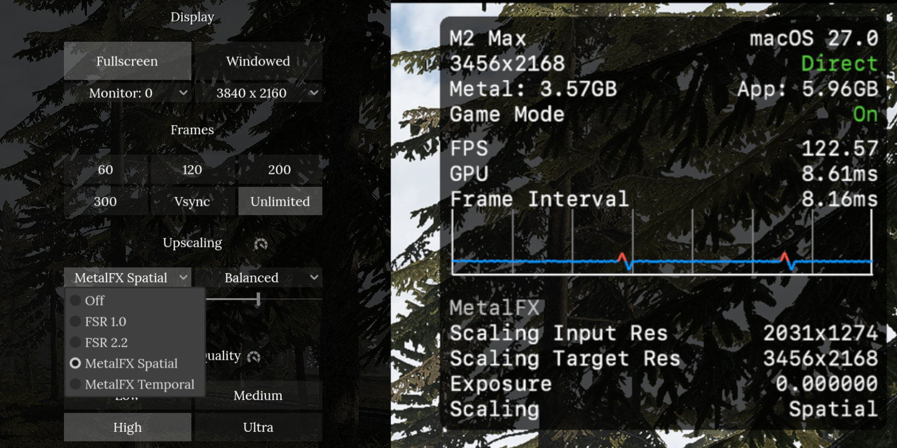

# Road to Vostok Mac Auto-Porter

An automated bash script that downloads the Road to Vostok game files, extracts them, recompiles the project and exports a native macOS (Apple Silicon / ARM) app.



*The native build on an M2 Max: the Upscaling dropdowns added by this script, and the Metal HUD showing MetalFX upscaling from 2031×1274 to the full 3456×2168 screen.*

⚠️ **You must own the game.** ([Steam Store Page](https://store.steampowered.com/app/1963610/Road_to_Vostok/)) This script does not distribute any game assets. It downloads them with your own Steam account, or uses an `RTV.pck` you already have.

Latest tested game version: **0.2.1.0**. Releases of this script are tagged with the game version they were tested against (`v0.2.1.0`).

## Quick start

1. Install SteamCMD:
   ```bash
   brew install steamcmd
   ```
2. Clone this repo and enter it:
   ```bash
   git clone https://github.com/Ozicom23/road-to-vostok-mac-build-script.git
   cd road-to-vostok-mac-build-script
   ```
   Don't want the repo? Download just the script into an empty folder instead:
   ```bash
   mkdir road-to-vostok && cd road-to-vostok
   curl -LO https://github.com/Ozicom23/road-to-vostok-mac-build-script/releases/latest/download/build_rtv_mac_arm_app.sh
   ```
3. Run the script with your Steam username:
   ```bash
   bash build_rtv_mac_arm_app.sh --steam-user your_steam_username
   ```
   SteamCMD asks for your Steam password and Steam Guard code, then downloads the game files (~6 GB) into this folder. The build starts right after.
4. Wait for it to finish. Extraction and texture compilation take a few minutes depending on your Mac.
5. Your app is `mac_build/RoadToVostok.app`. The script prints the full path at the end.

Running the script with `bash` bypasses macOS Gatekeeper restrictions on the script itself.

### Options

| Flag | What it does |
| --- | --- |
| `--steam-user <name>` | Download or update the game files into this folder with SteamCMD. |
| `--install` | Copy the finished app to `/Applications` (or `~/Applications` if that isn't writable), replacing a previous copy. |
| `--open` | Launch the app when the build is done. |
| `--force-extract` | Extract `RTV.pck` again even if it is unchanged since the last run. |

For example, to download, build, install and start the game in one go:

```bash
bash build_rtv_mac_arm_app.sh --steam-user your_steam_username --install --open
```

### Already have the game files?

If the game is installed somewhere else (a Windows PC, Steam in CrossOver/Whisky, or an earlier SteamCMD download), copy or move `RTV.pck` into this folder and run the script without arguments:

```bash
bash build_rtv_mac_arm_app.sh
```

Look for `RTV.pck` in your Steam library under `steamapps/common/Road to Vostok`. SteamCMD without an install dir puts it in `~/Library/Application Support/Steam/steamapps/common/Road to Vostok`.

### Updating the game

Run the script with `--steam-user` again. SteamCMD downloads only what changed, and the project is re-extracted and rebuilt from the updated files. If `RTV.pck` turns out to be unchanged, the extraction is skipped and only the export runs.

## What it does

1. Downloads or updates the game files with SteamCMD (when run with `--steam-user`).
2. Downloads the correct macOS `GDRE Tools` release.
3. Extracts your `RTV.pck` file. Later runs reuse the extracted project and Godot's texture cache while `RTV.pck` is unchanged, and re-apply the patches to pristine copies of the game files (`--force-extract` re-extracts).
4. Scrapes the recovery logs to find the exact Godot Engine version used to build the game.
5. Downloads that exact Godot Engine and its macOS Export Templates (~1GB).
6. Injects the necessary macOS ETC2 texture compression settings.
7. Applies macOS compatibility patches (see below).
8. Recompiles and exports a fully playable, native `RoadToVostok.app` to a `mac_build` folder.

## macOS compatibility patches

- **Ctrl → Cmd for item transfer** — remaps quick-transfer from `Ctrl+click` (intercepted by macOS as right-click) to `Cmd+click`.
- **Resolution presets** — replaces the screen-percentage window sizes with six presets (3840×2160 down to 1024×576), defaulting to 1920×1080. In windowed mode the preset sets the window size. In fullscreen, where macOS ignores window resizing, it sets the 3D render resolution instead.
- **Upscaling (FSR / MetalFX)** — the Rendering Low/Native buttons are replaced by two dropdowns under "Upscaling": the upscaler (Off, FSR 1.0, FSR 2.2, MetalFX Spatial, MetalFX Temporal) and its quality (Full, Quality, Balanced, Performance). The 3D scene renders at the resolution preset times the quality factor and the upscaler stretches it to the screen. The default is MetalFX Spatial at Full quality, which only sharpens the upscale and never ghosts. MetalFX Temporal gives the best image but, like FSR 2.2, can ghost on fast transparent effects. MetalFX needs Apple Silicon.
- **Native menu cursor** — the game shows its menu cursor in Godot's "confined" mouse mode, which macOS has no native support for. Godot emulates it by moving the cursor itself with raw, unaccelerated deltas, which makes it slow and jumpy. The patch uses the normal visible mode instead, so macOS drives the cursor. If the pointer still balloons when you move it fast, that is the system's "Shake mouse pointer to locate" setting under Accessibility → Display.

## Notes

- The Godot export ends with `ObjectDB instances leaked at exit` and `resources still in use at exit`. These come from Godot's editor shutting down, not from the build, and the app is unaffected.
- Game files, downloaded tools and build output are listed in `.gitignore`, so a `git add .` in this folder stays small.
